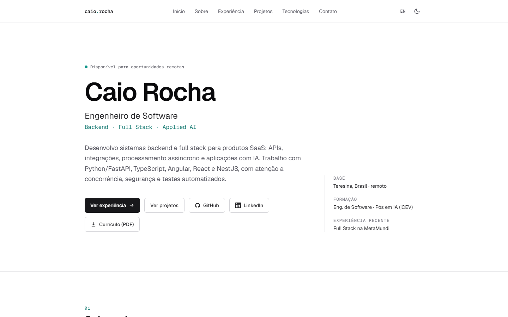
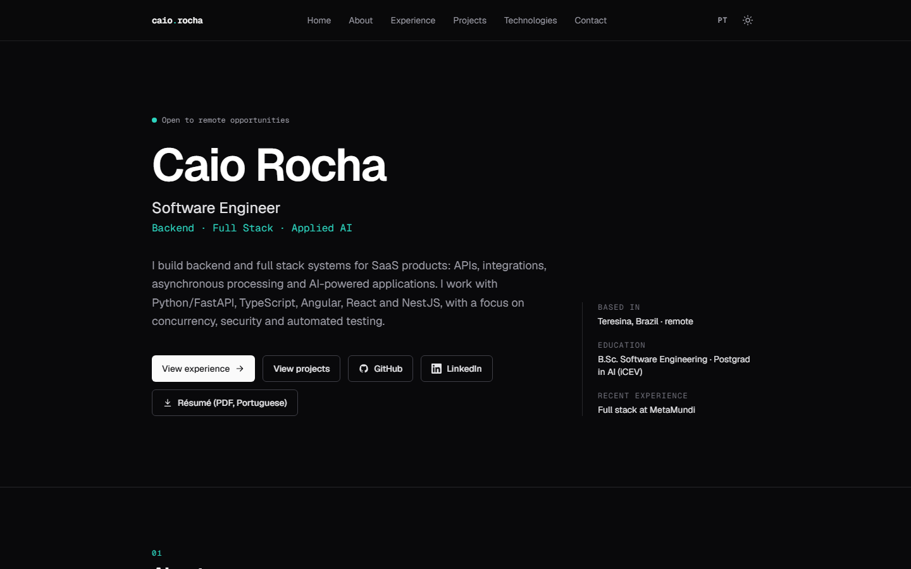

# Caio Rocha | Portfólio

[](https://github.com/caiorocha7/caio-rocha-portfolio/actions/workflows/ci.yml)

Site de portfólio de **Caio Rocha**, Engenheiro de Software (Backend · Full Stack · IA aplicada).
Apresenta três projetos completos com estudos de caso, capturas reais, testes e limitações documentadas.

**Site:** https://caiorocha7.github.io/caio-rocha-portfolio/

| Português                                   | English                                                           |
| ------------------------------------------- | ----------------------------------------------------------------- |
|  |  |

## Estrutura do site

Home: apresentação, sobre, experiência profissional (resumo), projetos pessoais, tecnologias e contato.

- `/pt/experience/` e `/en/experience/`: trajetória profissional (MetaMundi e Secretaria Municipal de Educação de Teresina).
- `/pt/experience/crmundi/` e `/en/experience/crmundi/`: estudo de caso da experiência na MetaMundi, com contribuições
  agrupadas por domínio e status de integração. O produto é proprietário: a página descreve apenas a contribuição do
  autor e não publica capturas, código, nomes internos, topologia de infraestrutura nem links de ambientes.
- `/pt/projects/<slug>/` e `/en/projects/<slug>/`: estudos de caso dos projetos pessoais.

## Projetos pessoais apresentados

| Projeto     | Foco                                                      | Repositório                                                                      |
| ----------- | --------------------------------------------------------- | -------------------------------------------------------------------------------- |
| RouteOps    | React + NestJS, gestão logística, modelagem de dados, E2E | [routeops-fullstack](https://github.com/caiorocha7/routeops-fullstack)           |
| DocPilot AI | RAG, segurança de LLMs, extração estruturada, avaliações  | [docpilot-ai](https://github.com/caiorocha7/docpilot-ai)                         |
| ConnectHub  | Webhooks, idempotência, filas, outbox transacional        | [connecthub-integrations](https://github.com/caiorocha7/connecthub-integrations) |

## Stack

- **Next.js 15** (App Router, export estático), **React 19**, **TypeScript**, **Tailwind CSS 4**
- Português (padrão) e inglês com URLs por idioma (`/pt`, `/en`), tema claro/escuro sem flash
- SEO: metadata por página, Open Graph, `hreflang`, canonical, sitemap e robots
- Testes: **Vitest + Testing Library** (componentes e integridade do conteúdo) e **Playwright** (E2E)
- **GitHub Actions**: lint, typecheck, testes, build, E2E e deploy no **GitHub Pages** (gratuito)

Sem backend: todo o conteúdo é estático e o contato é feito por e-mail e LinkedIn.

## Estrutura

```
src/
├── app/
│   ├── [locale]/              # layout raiz por idioma, home, páginas de projeto e experience/crmundi
│   ├── global-not-found.tsx   # 404 bilíngue
│   ├── sitemap.ts · robots.ts
├── components/                # Header, cards, links externos seguros, tema, idioma
├── data/                      # TODO o conteúdo: perfil, experiência, projetos, stack, textos da interface
├── lib/                       # i18n e URLs (basePath, URLs absolutas)
└── styles/globals.css
public/
├── projects/<slug>/*.webp     # capturas reais dos repositórios (geradas por pnpm images)
└── index.html                 # redireciona / para o idioma do navegador
scripts/                       # otimização de imagens, servidor estático, screenshots do site
e2e/                           # Playwright
docs/                          # manutenção e deploy, screenshots
```

## Desenvolvimento

```bash
pnpm install
pnpm dev            # http://localhost:3000/pt
pnpm lint && pnpm typecheck && pnpm test
pnpm test:e2e       # build com basePath + servidor estático + Playwright
```

No Windows/PowerShell, para gerar o build igual ao publicado:

```powershell
$env:NEXT_PUBLIC_BASE_PATH='/caio-rocha-portfolio'; pnpm build; pnpm start
# http://localhost:4321/caio-rocha-portfolio/
```

## Manutenção e deploy

Como atualizar textos, projetos e capturas, reativar o currículo e como publicar em outro host:
[docs/MAINTENANCE.md](docs/MAINTENANCE.md).

## Licença

Código sob licença MIT. Textos e capturas de tela pertencem ao autor.
